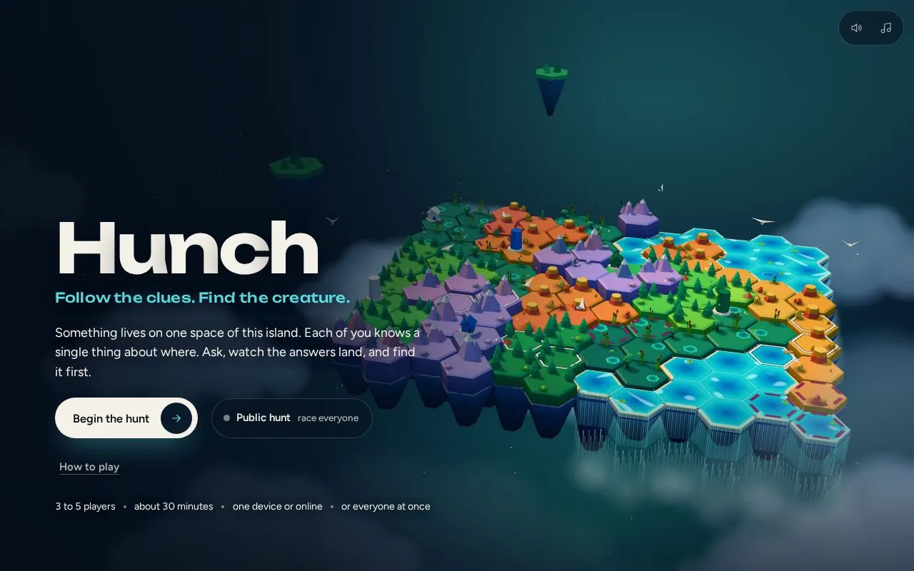

<div align="center">



# Hunch

**Follow the clues. Find the creature.**

[Play it](https://hunch.futile.studio) · [How it works](HOW-IT-WORKS.md) · [Futile Studio](https://futile.studio)

[](https://hunch.futile.studio)


</div>

> **Futile Studio · FS-005** · Games, party game · Live since Oct 2026

## Overview

A browser deduction game for 3 to 5 players, built on the mechanic of the board game *Cryptid*. A creature lives on one space of a hex map. Each player holds one private clue. You question each other about spaces, read the cubes and discs that come back, and race to search the habitat.

The 3D map is the interface. You pick spaces on a little floating island, and every answer drops onto it as a piece. Answers are computed from typed clues, so nobody can answer wrongly by mistake (the most common way the physical game falls apart at the table).

## How to play

1. Everyone gets one secret clue, like "on forest or swamp" or "within two spaces of a standing stone".
2. Before the first turn, each player places two cubes on spaces their clue rules out.
3. On your turn, **question** another player about a space. A disc means their clue allows it. A cube means it does not, and you owe a penalty cube on a space your own clue rules out.
4. Or **search** a space your clue allows. Everyone else answers in turn. A cube ends the search (and costs you a penalty cube). All discs means you found the creature and win.

There is a How to play screen in the game itself, so newcomers can learn as they go.

## Ways to play

- **Pass and play** on one device, with a hand-off screen that hides each clue.
- **Online rooms** with a four-letter code. The server holds the only copy of the clues and the habitat, and a refresh drops you back into your seat.
- **Public hunts** for everyone at once: one creature, one board, the same clues dropping on a server clock, and the first correct guess wins. Three rule sets (First to Find, Hot or Cold, One Shot), a reveal that replays how the clues closed in, a crowd heat map, and leaderboards. Load-tested at 400 hunters in one hunt.

## Features

- **Every map is generated** from a seed and checked to have exactly one habitat, with no redundant clue.
- **Hard mode** follows the rulebook's advanced game: "not" clues and black structures.
- **A notebook** lists the clues each player's pieces still fit, the pen-and-paper tracking the rulebook recommends.
- **Sound**: synthesised event effects and calm CC0 background music, each with its own switch.
- A flat SVG map takes over when WebGL is unavailable.
- Keyboard play, reduced-motion support and large touch targets.

## Stack

React 19, TypeScript and Vite for the client. Three.js for the board, GSAP and Motion for animation. One Node process runs Socket.IO for rooms and public hunts, with Zod checking every socket message. Node 22.18+ runs the server and tests as TypeScript directly, so the server has no build step. Tests use `node:test`.

## Running it locally

Needs Node 22.18 or newer.

```bash
npm install
npm run dev
```

The client runs on http://localhost:5190 and the Socket.IO server on :4351.

```bash
npm test
```

```bash
npm run build && npm start
```

`npm start` serves the built client and the sockets from one process on `PORT` (default 4351).

```bash
npm run load
```

Plays a 400-hunter public hunt against a real server process and prints latency, CPU and memory.

In development, `?demo=<seed>&steps=<n>` starts a four-player local game and auto-plays `n` legal moves, handy for screenshots.

## Configuration

All optional, read in `server/index.ts`:

| Variable | Purpose |
| --- | --- |
| `PORT` | Port for the server (default 4351) |
| `NODE_ENV` | `production` makes the server also serve the built client from `dist/` |
| `PUBLIC_CAPACITY` | Hunters per public hunt before a parallel one opens (default 400) |
| `PUBLIC_PACE` | Scales the public hunt clock, `0.25` runs it four times faster |
| `SOCKETS_PER_IP` | Simultaneous sockets from one address (default 24), raise it for an event on shared Wi-Fi |
| `PUBLIC_DATA` | Where leaderboards and stats are saved (default `data/public.json`) |

More detail on public hunts is in [HOW-IT-WORKS.md](HOW-IT-WORKS.md#public-hunts).

## Deployment

The `Dockerfile` builds a slim Node 22 image. On every push to `main`, a GitHub Action builds it, pushes it to GHCR and triggers a redeploy through Coolify. `deploy/compose.yaml` runs the container read-only, with no capabilities and a volume for `PUBLIC_DATA`.

## How it works

The rules engine, map generator, public hunts, privacy model and the 3D board are all written up in [HOW-IT-WORKS.md](HOW-IT-WORKS.md).

## Credits

Rules follow the official *Cryptid* rulebook. Map art, names and copy are original; no official tiles, clue-book text or artwork are used.

Background music is "Calm Down" by Rafael Archangel and "Chill Out Theme" by Komiku, both CC0 from Wikimedia Commons (see [public/sounds/CREDITS.md](public/sounds/CREDITS.md)). Fonts are Unbounded and Figtree (SIL OFL), self-hosted.

## Licence

No licence file yet, all rights reserved.

---

<p align="center"><sub>Built by <a href="https://github.com/MayurJivani">Mayur Jivani</a> at <a href="https://futile.studio">Futile Studio</a>. Everything is futile. Do it anyway.</sub></p>
